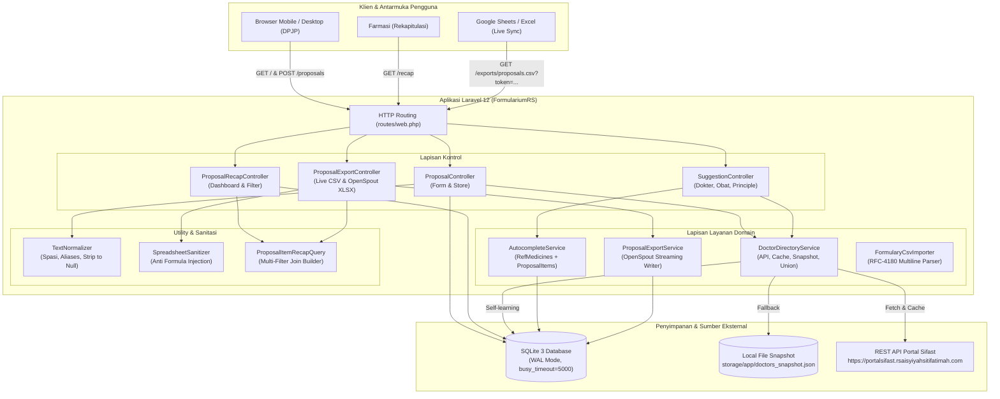
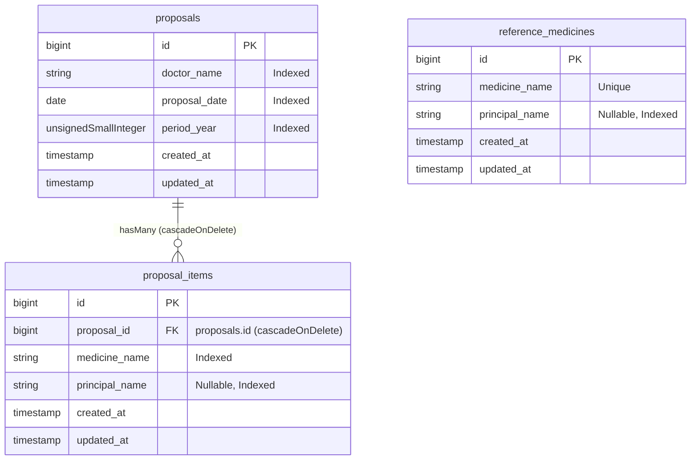

# Dokumentasi Teknis & Panduan Sistem
## Sistem Usulan Obat Formularium RS (RS Aisyiyah Siti Fatimah Tulangan)

Dokumen ini menyajikan panduan arsitektur, spesifikasi teknis, mekanisme kerja domain, kamus data, panduan operasional, hingga catatan penyesuaian teknis untuk **Sistem Usulan Obat Formularium RS Aisyiyah Siti Fatimah Tulangan**.

---

## Daftar Isi

- [1. Pendahuluan & Latar Belakang](#1-pendahuluan--latar-belakang)
  - [1.1 Konteks Operasional](#11-konteks-operasional)
  - [1.2 Masalah yang Diselesaikan](#12-masalah-yang-diselesaikan)
  - [1.3 Sasaran Sistem (*Key Objectives*)](#13-sasaran-sistem-key-objectives)
- [2. Arsitektur Sistem](#2-arsitektur-sistem)
  - [2.1 Stack Teknologi](#21-stack-teknologi)
- [3. Skema Basis Data & Konvensi](#3-skema-basis-data--konvensi)
  - [3.1 Tabel `proposals`](#31-tabel-proposals)
  - [3.2 Tabel `proposal_items`](#32-tabel-proposal_items)
  - [3.3 Tabel `reference_medicines`](#33-tabel-reference_medicines)
- [4. Mekanisme & Alur Kerja Komponen Inti](#4-mekanisme--alur-kerja-komponen-inti)
  - [4.1 Formulir Usulan Obat & Dynamic Repeater (`proposals.create`)](#41-formulir-usulan-obat--dynamic-repeater-proposalscreate)
  - [4.2 Pencegahan Double-Submit & Integritas Transaksi](#42-pencegahan-double-submit--integritas-transaksi)
  - [4.3 Ketahanan Integrasi Dokter (`DoctorDirectoryService`)](#43-ketahanan-integrasi-dokter-doctordirectoryservice)
  - [4.4 Autocomplete Hibrida & Self-Learning Obat (`AutocompleteService`)](#44-autocomplete-hibrida--self-learning-obat-autocompleteservice)
  - [4.5 Halaman Rekapitulasi & Filter Multi-Dimensi (`proposals.index`)](#45-halaman-rekapitulasi--filter-multi-dimensi-proposalsindex)
  - [4.6 Live Spreadsheet Feed & Ekspor Excel Bergaya](#46-live-spreadsheet-feed--ekspor-excel-bergaya)
    - [4.6.1 Karakteristik Pembaruan Data & Sinkronisasi (Update Behavior)](#461-karakteristik-pembaruan-data--sinkronisasi-update-behavior)
- [5. Ringkasan Penyesuaian di Luar Rencana Awal (*Plan Deviations*)](#5-ringkasan-penyesuaian-di-luar-rencana-awal-plan-deviations)
- [6. Referensi Rute & API](#6-referensi-rute--api)
- [7. Panduan Instalasi, Konfigurasi & Operasional](#7-panduan-instalasi-konfigurasi--operasional)
  - [7.1 Persyaratan Sistem](#71-persyaratan-sistem)
  - [7.2 Langkah Instalasi Baru](#72-langkah-instalasi-baru)
  - [7.3 Konfigurasi Environment (`.env`)](#73-konfigurasi-environment-env)
    - [7.3.1 Prosedur Pembuatan & Validasi FORMULARY_FEED_TOKEN](#731-prosedur-pembuatan--validasi-formulary_feed_token)
  - [7.4 Perintah Operasional Berkala](#74-perintah-operasional-berkala)
- [8. Verifikasi Kualitas & Pengujian Otomatis](#8-verifikasi-kualitas--pengujian-otomatis)
  - [8.1 Menjalankan Pengujian](#81-menjalankan-pengujian)
  - [8.2 Ringkasan Cakupan Test (28 Tests / 159 Assertions)](#82-ringkasan-cakupan-test-28-tests--159-assertions)

---

## 1. Pendahuluan & Latar Belakang

### 1.1 Konteks Operasional
Setiap tahun pada bulan November, Rumah Sakit Aisyiyah Siti Fatimah Tulangan menyelenggarakan siklus peninjauan dan pembaruan Formularium Rumah Sakit melalui Farmasi. Para Dokter Penanggung Jawab Pelayanan (DPJP) — baik dokter spesialis poliklinik, dokter rawat inap, anestesi, patologi, maupun dokter IGD — mengusulkan obat-obat baru beserta principle pabrikan yang dibutuhkan untuk pelayanan medis satu tahun ke depan.

### 1.2 Masalah yang Diselesaikan
Sebelum sistem ini dibangun, pengumpulan usulan menggunakan Google Form konvensional yang memiliki kendala:
1. **Tidak Mendukung Input Baris Berulang (*Dynamic Form Repeater*):** Dokter harus mengisi form berulang kali jika ingin mengusulkan lebih dari satu obat, atau menuliskannya dalam satu kolom teks panjang yang menyulitkan rekapitulasi data.
2. **Ketiadaan Kamus Standar & Typos:** Penulisan nama obat dan principle sering kali tidak konsisten (contoh: "Novel" vs "Novell", perbedaan format kapitalisasi atau dosis), sehingga Tim Farmasi harus melakukan pembersihan data manual yang memakan waktu.
3. **Data Dokter Terpisah:** Formulir tidak terhubung dengan direktori resmi SIMRS/PortalSifast.
4. **Keterlambatan Sinkronisasi:** Rekapitulasi usulan harus diekspor secara manual ke Excel dan berisiko tertinggal data usulan terbaru.

### 1.3 Sasaran Sistem (*Key Objectives*)
- **Zero-Friction Access:** Pengisian formulir tidak memerlukan login/akun/PIN, sangat ringan, dan dioptimalkan untuk perangkat mobile dokter (diakses via tautan WhatsApp saat visit bangsal).
- **Multi-Item Entry:** Satu sesi pengajuan dapat memuat 1 hingga 50 obat dalam satu formulir secara atomik.
- **Resilient Doctor Directory:** Pengambilan data dokter dari REST API Portal Sifast dengan caching 12 jam, snapshot fallback lokal saat API down, serta dukungan pengetikan dokter manual (*self-learning*).
- **Self-Learning Autocomplete & Auto-Fill:** Autocomplete nama obat dan principle menggabungkan kamus awal (~206 obat referensi RS) dengan data usulan yang baru saja masuk (*self-learning*), lengkap dengan pengisian otomatis (*auto-fill*) nama principle saat obat dipilih.
- **Live Spreadsheet Sync & Professional Export:** Sinkronisasi langsung ke Google Sheets melalui rumus `=IMPORTDATA(...)` ber-token rahasia, integrasi Microsoft Excel Power Query, serta ekspor file `.xlsx` siap cetak dengan styling resmi hijau zamrud RS.

---

## 2. Arsitektur Sistem

Aplikasi dibangun dengan arsitektur **Monolitik Ringan (*Lightweight Monolith*)** yang mengutamakan kecepatan eksekusi, portabilitas tinggi, dan pemeliharaan tahunan yang minimal (*low maintenance*).



### 2.1 Stack Teknologi
- **Bahasa & Framework:** PHP `^8.3`, Laravel `^12.0` (arsitektur modern berbasis `bootstrap/app.php`).
- **Database Utama:** SQLite 3 dengan konfigurasi tingkat produksi:
  - `journal_mode = WAL` (*Write-Ahead Logging*) untuk mendukung konkuren baca/tulis tinggi tanpa locking.
  - `busy_timeout = 5000` (toleransi antrean transaksi hingga 5 detik).
  - `synchronous = NORMAL` untuk throughput optimal.
  - `foreign_key_constraints = true`.
- **Frontend Stack:**
  - **Laravel Blade Components:** Menjamin server-side rendering cepat dan SEO/struktur bersih.
  - **Alpine.js `^3.14`:** Dibundel lokal melalui Vite (`resources/js/app.js`), tanpa ketergantungan CDN eksternal agar tetap responsif saat koneksi internet rumah sakit melambat.
  - **Tailwind CSS `^4.0`:** Menggunakan `@tailwindcss/vite` modern dengan variabel tema kustom di `resources/css/app.css`.
- **Spreadsheet Engine:** `openspout/openspout:^4.32` untuk ekspor file `.xlsx` dengan streaming memori konstan (< 10 MB) meskipun data berjumlah ribuan baris.
- **Testing & Quality Assurance:** Pest PHP `^3.0` (28 tests, 159 assertions), Laravel Pint.

---

## 3. Skema Basis Data & Konvensi

Struktur database mengikuti prinsip normalisasi master-detail yang terindeks secara optimal untuk pencarian cepat. Semua penamaan tabel, kolom, model, dan relasi ditulis dalam **100% Bahasa Inggris baku**.



### 3.1 Tabel `proposals`
Menyimpan sesi pengajuan formulir oleh dokter.
- `id` (`bigint`, Primary Key, Auto Increment).
- `doctor_name` (`varchar(255)`, Not Null, Index): Nama dokter yang mengajukan.
- `proposal_date` (`date`, Not Null, Index): Tanggal usulan diajukan (format `YYYY-MM-DD`).
- `period_year` (`smallint`, Not Null, Index): Tahun periode usulan (diekstrak otomatis dari `proposal_date`, misal: `2026`).
- `created_at`, `updated_at` (`timestamp`).
- **Model:** `App\Models\Proposal` ([Proposal.php](file:///Users/adijaya/MyFiles/Projects/RSAisyiahSitiFatimahTulangan/FormulariumRS/app/Models/Proposal.php)).
- **Relasi:** `items(): HasMany` menuju `ProposalItem`.

### 3.2 Tabel `proposal_items`
Menyimpan rincian setiap obat yang diusulkan dalam suatu proposal.
- `id` (`bigint`, Primary Key, Auto Increment).
- `proposal_id` (`bigint`, Foreign Key ke `proposals.id`, `onDelete('cascade')`).
- `medicine_name` (`varchar(255)`, Not Null, Index): Nama obat dan bentuk sediaan.
- `principal_name` (`varchar(255)`, Nullable, Index): Nama pabrikan/principle obat. Bernilai `null` jika tidak diisi atau hanya berisi strip `"-"`.
- `created_at`, `updated_at` (`timestamp`).
- **Model:** `App\Models\ProposalItem` ([ProposalItem.php](file:///Users/adijaya/MyFiles/Projects/RSAisyiahSitiFatimahTulangan/FormulariumRS/app/Models/ProposalItem.php)).
- **Relasi:** `proposal(): BelongsTo` menuju `Proposal`.

### 3.3 Tabel `reference_medicines`
Kamus referensi read-only berisi 206 daftar obat dasar RS beserta pasangan principle awalnya.
- `id` (`bigint`, Primary Key, Auto Increment).
- `medicine_name` (`varchar(255)`, Unique): Nama baku obat.
- `principal_name` (`varchar(255)`, Nullable, Index): Nama pabrikan resmi.
- `created_at`, `updated_at` (`timestamp`).
- **Model:** `App\Models\ReferenceMedicine` ([ReferenceMedicine.php](file:///Users/adijaya/MyFiles/Projects/RSAisyiahSitiFatimahTulangan/FormulariumRS/app/Models/ReferenceMedicine.php)).
- **Sifat:** Read-only saat dokter mengajukan formulir. Hanya diisi/diperbarui via Seeder atau Artisan Command `php artisan formulary:import-csv`.

---

## 4. Mekanisme & Alur Kerja Komponen Inti

### 4.1 Formulir Usulan Obat & Dynamic Repeater (`proposals.create`)
- **Lokasi View:** [create.blade.php](file:///Users/adijaya/MyFiles/Projects/RSAisyiahSitiFatimahTulangan/FormulariumRS/resources/views/proposals/create.blade.php)
- **Komponen Alpine.js:** `proposalForm`, `medicineAutocomplete`, `principalAutocomplete` di [app.js](file:///Users/adijaya/MyFiles/Projects/RSAisyiahSitiFatimahTulangan/FormulariumRS/resources/js/app.js).
- **Alur Kerja Pengisian:**
  1. Dokter membuka halaman `GET /`.
  2. Input Nama Dokter menggunakan *Searchable Combobox* terintegrasi ke `/api/suggestions/doctors?q=...` dengan debounce 200ms. Jika nama dokter tidak terdaftar (misal Sp.An atau dokter pengganti), muncul tombol `+ Gunakan nama dokter: "{ketikan}"`.
  3. Tanggal usulan default terisi tanggal hari ini (`now()->toDateString()`).
  4. Bagian obat menyediakan baris dinamis (default 1 baris, dapat ditambah hingga 50 baris via tombol *Tambah Baris Obat Lainnya*).
  5. Pada kolom *Nama Obat*, dokter mengetikkan nama obat. Autocomplete menampilkan hingga 15 kandidat teratas. Memilih saran obat otomatis mengisi kolom *Nama Principle* jika ada (*auto-fill*).
  6. Dokter dapat mengedit atau mengosongkan principle tanpa batasan.
  7. Saat tombol submit ditekan:
     - Client-side mengunci tombol (`disabled`) dan menampilkan status spinner loading.
     - Form dikirim ke `POST /proposals` dengan token CSRF.

### 4.2 Pencegahan Double-Submit & Integritas Transaksi
- **Request Form:** [StoreProposalRequest.php](file:///Users/adijaya/MyFiles/Projects/RSAisyiahSitiFatimahTulangan/FormulariumRS/app/Http/Requests/StoreProposalRequest.php)
  - Sebelum validasi, input dinormalisasi: spasi ganda dihapus via [`TextNormalizer::collapseWhitespace`](file:///Users/adijaya/MyFiles/Projects/RSAisyiahSitiFatimahTulangan/FormulariumRS/app/Support/TextNormalizer.php), dan principle bernilai `"-"` diubah menjadi `null` via [`TextNormalizer::normalizePrincipal`](file:///Users/adijaya/MyFiles/Projects/RSAisyiahSitiFatimahTulangan/FormulariumRS/app/Support/TextNormalizer.php).
- **Pengontrol Transaksi:** [ProposalController.php](file:///Users/adijaya/MyFiles/Projects/RSAisyiahSitiFatimahTulangan/FormulariumRS/app/Http/Controllers/ProposalController.php#L28-L64)
  - **Idempotency Fingerprint:** Dibuat hash SHA-256 dari payload ternormalisasi (`doctor_name`, `proposal_date`, dan array `items`).
  - Dilakukan penguncian cache: `Cache::add("formulary:idempotency:{$fingerprint}", true, now()->addSeconds(15))`.
  - Jika fingerprint sudah ada dalam jeda 15 detik (misal akibat klik ganda dokter pada koneksi lambat), transaksi duplikat diabaikan namun tetap mengembalikan respon sukses yang ramah.
  - Jika fingerprint baru, pembuatan master `Proposal` dan rincian `ProposalItem` dieksekusi di dalam blok `DB::transaction()`.
  - Data ringkasan disimpan ke flash session `submitted_summary` dan dialihkan (redirect) kembali ke formulir, mencegah form resubmit jika halaman direfresh.

### 4.3 Ketahanan Integrasi Dokter (`DoctorDirectoryService`)
- **Lokasi:** [DoctorDirectoryService.php](file:///Users/adijaya/MyFiles/Projects/RSAisyiahSitiFatimahTulangan/FormulariumRS/app/Services/DoctorDirectoryService.php)
- **Strategi Multi-Tier Resiliency:**
  1. **Tier 1 (Cache Memori):** Cek cache `formulary.doctors.api_list` (berlaku 12 jam).
  2. **Tier 2 (Portal Sifast REST API):** Jika cache kosong, panggil `config('formulary.doctor_api_url')` dengan timeout 10 detik dan retry 2x. Hasil valid disimpan ke cache dan ditulis ulang ke file lokal `storage/app/doctors_snapshot.json`.
  3. **Tier 3 (Snapshot Lokal):** Jika API mengembalikan error 500, timeout, payload kosong, atau HTML maintenance, sistem membaca snapshot `storage/app/doctors_snapshot.json` dan menyimpannya di cache selama 15 menit agar request pengguna berikutnya tidak terhambat network delay.
  4. **Tier 4 (Self-Learning Manual Doctors):** Menggabungkan dokter dari API/snapshot dengan `Proposal::query()->distinct()->pluck('doctor_name')` secara case-insensitive. Dokter manual yang pernah diajukan langsung otomatis menjadi opsi pada pencarian selanjutnya.

### 4.4 Autocomplete Hibrida & Self-Learning Obat (`AutocompleteService`)
- **Lokasi:** [AutocompleteService.php](file:///Users/adijaya/MyFiles/Projects/RSAisyiahSitiFatimahTulangan/FormulariumRS/app/Services/AutocompleteService.php)
- **Mekanisme Penggabungan:**
  - Mengambil kandidat dari `ReferenceMedicine` (kamus dasar) dan `ProposalItem` (riwayat input dokter).
  - Menggabungkan data secara *case-insensitive* di memori PHP.
  - Memprioritaskan ejaan baku dari kamus referensi, tetapi melengkapi nama principle jika di kamus referensi kosong sedangkan di riwayat usulan ada principle yang terisi.
  - Urutan hasil: kandidat yang diawali oleh kata kunci pengguna (*prefix match*) diposisikan lebih dulu, diikuti urutan alfabetis.
  - Endpoint dibatasi maksimal 15 hasil untuk menjaga latensi jaringan di bawah 50ms.

### 4.5 Halaman Rekapitulasi & Filter Multi-Dimensi (`proposals.index`)
- **Lokasi Controller & View:** [ProposalRecapController.php](file:///Users/adijaya/MyFiles/Projects/RSAisyiahSitiFatimahTulangan/FormulariumRS/app/Http/Controllers/ProposalRecapController.php) & [index.blade.php](file:///Users/adijaya/MyFiles/Projects/RSAisyiahSitiFatimahTulangan/FormulariumRS/resources/views/proposals/index.blade.php).
- **Query Builder:** [`ProposalItemRecapQuery::build($filters)`](file:///Users/adijaya/MyFiles/Projects/RSAisyiahSitiFatimahTulangan/FormulariumRS/app/Queries/ProposalItemRecapQuery.php) menggabungkan tabel `proposals` dan `proposal_items` dengan klausa join ANSI-SQL yang 100% kompatibel di SQLite maupun MariaDB.
- **Fitur Tampilan:**
  - **3 Kartu Metrik:** Menampilkan *Total Obat Diusulkan*, *Dokter Berpartisipasi*, dan *Pengiriman Formulir* yang nilainya responsif mengikuti filter yang diterapkan.
  - **Chip Cepat Tahun Periode:** Pilihan tombol instan untuk memilih tahun usulan (misal: `Semua Tahun`, `2026`, `2025`).
  - **Komponen Searchable Select:** Filter dropdown *Dokter* dan *Principle* menggunakan komponen kustom Blade `<x-custom-select>` dengan fitur pencarian teks di dalam dropdown dan navigasi keyboard.
  - **Rentang Tanggal & Kata Kunci:** Mendukung filter tanggal awal-akhir dan pencarian bebas pada nama obat, dokter, maupun pabrikan.
  - **Paginasi:** 25 baris per halaman dengan mempertahankan query string filter.

### 4.6 Live Spreadsheet Feed & Ekspor Excel Bergaya
- **Live CSV Feed (`/exports/proposals.csv?token=...`):**
  - Dilindungi token rahasia `config('formulary.feed_token')` dengan perbandingan waktu-konstan [`hash_equals`](file:///Users/adijaya/MyFiles/Projects/RSAisyiahSitiFatimahTulangan/FormulariumRS/app/Http/Controllers/ProposalExportController.php#L24). Request tanpa token atau token tidak valid langsung ditolak dengan status HTTP 403.
  - Response dialirkan (*streamed*) dalam format UTF-8 dengan header `Cache-Control: no-store, no-cache, must-revalidate, max-age=0` dan `Pragma: no-cache`.
  - Format tanggal: `d/m/Y` (DD/MM/YYYY) agar konsisten saat dibaca Google Sheets dan Excel regional Indonesia.
  - Kolom output: `No, Tanggal, Tahun Periode, Nama Dokter, Nama Obat, Nama Principle, Alasan Klinis, Catatan Pengusul`.
  - Dilengkapi rumus Google Sheets siap salin 1-klik: `=IMPORTDATA("https://domain-rs/exports/proposals.csv?token=...")`.
- **Ekspor Excel XLSX (`/exports/proposals.xlsx`):**
  - Dibangun oleh [`ProposalExportService`](file:///Users/adijaya/MyFiles/Projects/RSAisyiahSitiFatimahTulangan/FormulariumRS/app/Services/ProposalExportService.php) menggunakan `OpenSpout`.
  - Memproses baris secara bertahap (`chunk(250)`) untuk efisiensi memori (< 10 MB).
  - Judul laporan: *"REKAPITULASI USULAN OBAT FORMULARIUM RS AISYIYAH SITI FATIMAH TULANGAN"* dengan font tebal hijau zamrud.
  - Header tabel menggunakan warna khas rumah sakit: latar hijau zamrud (`Color::rgb(6, 95, 70)`), teks putih tebal, dan border tipis abu-abu.
  - Lebar kolom diatur proporsional (No: 8, Tanggal: 14, Tahun Periode: 14, Nama Dokter: 35, Nama Obat: 40, Nama Principle: 25, Alasan Klinis: 45, Catatan Pengusul: 35).
- **Pencegahan Spreadsheet Formula Injection (CSV Injection):**
  - Melalui [`SpreadsheetSanitizer::sanitizeCell`](file:///Users/adijaya/MyFiles/Projects/RSAisyiahSitiFatimahTulangan/FormulariumRS/app/Support/SpreadsheetSanitizer.php), nilai sel yang diawali karakter berisiko (`=`, `+`, `-`, `@`, tab `\t`, atau carriage return `\r`) otomatis diawali tanda kutip tunggal (`'`). Nilai `null` pada kolom principle dirender sebagai strip aman `"-"`.

#### 4.6.1 Karakteristik Pembaruan Data & Sinkronisasi (Update Behavior)
Banyak pengguna menanyakan: *Apakah spreadsheet otomatis ter-update apabila ada usulan obat baru yang masuk?*

Berikut adalah rincian teknis alur pembaruan data antar platform:

1. **Sisi Server Aplikasi Formularium RS (Real-Time):**
   - Usulan baru yang dikirimkan oleh dokter langsung tersimpan saat itu juga di database SQLite.
   - Endpoint Live CSV (`/exports/proposals.csv`) **tidak menahan cache server** (`no-cache, max-age=0`). Setiap request HTTP yang masuk ke endpoint ini akan langsung mengeksekusi query database dan menghasilkan baris data usulan paling mutakhir.

2. **Sisi Google Sheets (`=IMPORTDATA`):**
   - **Internal Caching Google (1–2 Jam):** Google Sheets memiliki mekanisme perayapan (*crawler*) internal yang menahan cache respons URL eksternal selama **±1 hingga 2 jam**. Oleh karena itu, data usulan baru yang baru saja dikirim dokter **tidak langsung muncul seketika** di Google Sheets jika hanya ditunggu dalam hitungan detik/menit.
   - **Metode Force Refresh Instan di Google Sheets:**
     - **Trik Hapus & Undo (Paling Praktis):** Klik sel `A1` (tempat formula `=IMPORTDATA(...)`), tekan tombol `Delete`, lalu segera tekan `Ctrl + Z` (Undo). Google Sheets akan langsung dipaksa menarik data baru dari server tanpa menunggu jeda cache.
     - **Trik URL Cache-Busting:** Menambahkan parameter versi pada formula, contoh:
       ```excel
       =IMPORTDATA("https://domain-rs/exports/proposals.csv?token=...&v=1")
       ```
       Ubah angka parameter `v=1` menjadi `v=2` kapan pun ingin memaksa pembaruan data seketika.
     - **Google Apps Script / Tombol Macro (Opsional):** Jika tim Farmasi menginginkan tombol khusus *"Segarkan Usulan"* di spreadsheet, dapat dibuatkan fungsi Apps Script sederhana yang memperbarui sel formula secara otomatis.

3. **Sisi Microsoft Excel (Power Query / Dari Web):**
   - **On-Demand (Manual Refresh):** Excel tidak memperbarui data eksternal terus-menerus secara *streaming*. Data baru akan masuk setelah pengguna membuka tab **Data** &rarr; klik tombol **Segarkan Semua (Refresh All)**.
   - **Konfigurasi Auto-Refresh:** Agar Excel otomatis memperbarui data secara berkala:
     1. Buka tab **Data** &rarr; klik **Kueri & Koneksi (Queries & Connections)**.
     2. Klik kanan pada kueri usulan &rarr; pilih **Properti (Properties)**.
     3. Centang opsi **Segarkan setiap (Refresh every)** dan tentukan durasi (misalnya setiap 5 menit).
     4. Centang opsi **Segarkan data saat membuka file (Refresh data when opening the file)**.

4. **Sisi Unduhan File Excel (`.xlsx`):**
   - File `.xlsx` yang diunduh melalui tombol *"Export ke Excel (.xlsx)"* berstatus **snapshot statis**.
   - Berkas yang sudah tersimpan di komputer pengguna tidak akan berubah otomatis ketika ada usulan baru; pengguna perlu mengklik tombol unduh kembali dari sistem untuk mendapatkan file terbaru.

---

## 5. Ringkasan Penyesuaian di Luar Rencana Awal (*Plan Deviations*)

Selama proses implementasi nyata, dilakukan beberapa penyesuaian teknis untuk menyempurnakan keandalan, keamanan, dan UX:

| Area / Komponen | Rencana Awal (Plan) | Realisasi Implementasi | Alasan & Manfaat Teknis |
| :--- | :--- | :--- | :--- |
| **Pencarian Nama Dokter** | Inject seluruh array dokter ke HTML Blade saat render halaman. | Remote autocomplete debounced via endpoint `/api/suggestions/doctors?q=...` dengan `AbortController`. | Mencegah HTML membengkak, mengurangi beban inisialisasi Alpine.js di perangkat mobile spek rendah, serta membatalkan request lama saat dokter mengetik cepat. |
| **State Awal Repeater Form** | Mengoper `old('items')` langsung ke atribut HTML `x-data="proposalForm(@json(...))"`. | Mengisolasi data awal dalam tag `<script id="proposal-form-data" type="application/json">`. | Mencegah truncation/kerusakan parser HTML saat nama obat atau dokter mengandung tanda petik tunggal (`'`), petik ganda (`"`), atau karakter khusus. |
| **Filter Dropdown Rekapitulasi** | Menggunakan elemen native HTML `<select>`. | Membangun komponen custom `<x-custom-select>` dengan pencarian internal dan navigasi keyboard. | Elemen select native menyulitkan pencarian ketika dokter atau principle berjumlah puluhan/ratusan; custom select memberikan pengalaman modern dan pencarian instan. |
| **Stacking Context & Nested Button** | Menggunakan trigger button yang membungkus seluruh isi dropdown. | Memisahkan trigger text dan action clear/chevron menjadi sibling elements, serta penyesuaian z-index. | Memperbaiki layout breakage akibat elemen `<button>` bersarang di HTML serta mencegah dropdown tertimpa baris tabel di bawahnya. |
| **Dataset Seeder Awal** | Murni hanya mengimpor CSV dasar 206 obat. | Ditambahkan `FormulariumDataSeeder` yang menyelaraskan dokter API dan memetakan string dokter lama secara cerdas. | Memastikan database langsung siap pakai dengan data representatif untuk pengujian Farmasi dan evaluasi live rekapitulasi. |
| **Reverse Proxy & HTTPS** | Belum terdefinisi spesifik di bootstrap middleware. | Ditambahkan `$middleware->trustProxies(at: '*')` pada `bootstrap/app.php`. | Menjamin deteksi skema HTTPS, IP client asli, dan URL generator berfungsi benar saat aplikasi dijalankan di balik reverse proxy / load balancer. |
| **Kolom Tanggal Live CSV** | Terdapat kolom 'Waktu Input' dan format ISO standar. | Format tanggal diseragamkan `d/m/Y`, kolom waktu input dihilangkan dari CSV live, dan ditambah panduan format tanggal di modal. | Google Sheets sering salah membaca string ISO tanggal sebagai teks atau format angka serial; format `d/m/Y` langsung dikenali sebagai tanggal lokal Indonesia. |

---

## 6. Referensi Rute & API

| HTTP Method | URI Path | Nama Rute | Controller & Action | Fungsi & Output |
| :--- | :--- | :--- | :--- | :--- |
| `GET` | `/` | `proposals.create` | `ProposalController@create` | Menampilkan antarmuka formulir pengajuan obat untuk dokter. |
| `POST` | `/proposals` | `proposals.store` | `ProposalController@store` | Menyimpan usulan obat secara atomik (throttled: 30 request/menit, validasi 1–50 item). |
| `GET` | `/recap` | `proposals.index` | `ProposalRecapController@index` | Dashboard rekapitulasi usulan, kartu metrik, filter, dan modal Live Spreadsheet. |
| `GET` | `/api/suggestions/doctors` | `suggestions.doctors` | `SuggestionController@doctors` | JSON autocomplete dokter aktif (`?q=nama`). Output: `{"data": [{"name": "...", "clinic": "..."}]}`. |
| `GET` | `/api/suggestions/medicines` | `suggestions.medicines` | `SuggestionController@medicines` | JSON autocomplete obat (`?q=nama`). Output: `{"data": [{"medicine_name": "...", "principal_name": "..."}]}`. |
| `GET` | `/api/suggestions/principals` | `suggestions.principals` | `SuggestionController@principals` | JSON autocomplete principle (`?q=nama`). Output: `{"data": ["Novell", "Sanbe", ...]}`. |
| `GET` | `/exports/proposals.csv` | `exports.proposals.csv` | `ProposalExportController@csv` | Stream data CSV terfilter untuk Google Sheets `=IMPORTDATA` (memerlukan `?token=...`). |
| `GET` | `/exports/proposals.xlsx` | `exports.proposals.xlsx` | `ProposalExportController@xlsx` | Download file spreadsheet `.xlsx` terformat rapi sesuai filter aktif di halaman rekapitulasi. |

---

## 7. Panduan Instalasi, Konfigurasi & Operasional

### 7.1 Persyaratan Sistem
- PHP `^8.3` dengan ekstensi: `pdo_sqlite`, `mbstring`, `openssl`, `tokenizer`, `xml`, `ctype`, `json`, `curl`, `zip`.
- Composer `^2.7`.
- Node.js `^20.0` & NPM `^10.0`.
- SQLite 3 (mendukung WAL mode).

### 7.2 Langkah Instalasi Baru
```bash
# 1. Masuk ke direktori proyek
cd /Users/adijaya/MyFiles/Projects/RSAisyiahSitiFatimahTulangan/FormulariumRS

# 2. Pasang dependensi PHP dan Node.js
composer install --no-interaction --prefer-dist
npm install

# 3. Siapkan file konfigurasi lingkungan
cp .env.example .env
php artisan key:generate

# 4. Siapkan database SQLite
touch database/database.sqlite

# 5. Jalankan migrasi dan seeder awal
php artisan migrate:fresh --seed

# 6. Kompilasi aset frontend
npm run build
```

### 7.3 Konfigurasi Environment (`.env`)
Pastikan parameter berikut dikonfigurasi dengan benar:

```dotenv
APP_NAME="Formularium RS"
APP_ENV=production
APP_DEBUG=false
APP_TIMEZONE=Asia/Jakarta
APP_LOCALE=id

DB_CONNECTION=sqlite
DB_FOREIGN_KEYS=true

# URL API Direktori Dokter Portal Sifast RS
FORMULARY_DOCTOR_API_URL="https://portalsifast.rsaisyiyahsitifatimah.com/api/dokter"
FORMULARY_DOCTOR_API_TIMEOUT=10
FORMULARY_DOCTOR_CACHE_TTL_HOURS=12

# Token keamanan live CSV feed (wajib string acak aman minimal 32 karakter)
FORMULARY_FEED_TOKEN="ganti_dengan_token_rahasia_32_karakter"
```

#### 7.3.1 Prosedur Pembuatan & Validasi FORMULARY_FEED_TOKEN
Variabel `FORMULARY_FEED_TOKEN` bertindak sebagai *shared secret* untuk mengamankan live feed CSV (`/exports/proposals.csv?token=...`) yang dikonsumsi oleh Google Sheets (`=IMPORTDATA`) dan Excel Power Query. Di sisi backend ([`ProposalExportController::csv`](file:///Users/adijaya/MyFiles/Projects/RSAisyiahSitiFatimahTulangan/FormulariumRS/app/Http/Controllers/ProposalExportController.php#L24)), validasi dilakukan menggunakan `hash_equals()` untuk mencegah celah keamanan *timing attack*.

##### Pilihan Perintah Pembuatan Token (CSPRNG):
1. **PHP CLI (Standar & Rekomendasi):**
   ```bash
   php -r "echo bin2hex(random_bytes(16)) . PHP_EOL;"
   ```
2. **Laravel Artisan / Tinker:**
   ```bash
   php artisan tinker --execute="echo Str::random(32);"
   ```
3. **OpenSSL Terminal (macOS / Linux):**
   ```bash
   openssl rand -hex 16
   ```
4. **Pembaruan Otomatis ke `.env` Sekali Eksekusi (macOS / Linux):**
   ```bash
   NEW_TOKEN=$(php -r "echo bin2hex(random_bytes(16));")
   sed -i '' "s/^FORMULARY_FEED_TOKEN=.*/FORMULARY_FEED_TOKEN=${NEW_TOKEN}/" .env
   php artisan config:clear
   echo "Token terpasang: ${NEW_TOKEN}"
   ```

##### Prosedur Verifikasi:
- **Pengujian via cURL:**
  ```bash
  # Uji token valid (ekspektasi: HTTP/1.1 200 OK)
  curl -I "http://localhost:8000/exports/proposals.csv?token=TOKEN_ANDA"

  # Uji tanpa token atau token keliru (ekspektasi: HTTP/1.1 403 Forbidden)
  curl -I "http://localhost:8000/exports/proposals.csv"
  ```
- **Pengujian UI Rekapitulasi:**
  Akses menu rekapitulasi pada browser (`/recap`), klik tombol **"Sinkronisasi Google Sheets / Excel"**, lalu pastikan URL feed dan formula `=IMPORTDATA("...")` yang disalin secara otomatis telah menyertakan token aktif tersebut.

### 7.4 Perintah Operasional Berkala
- **Import/Perbarui Kamus Referensi CSV:**
  ```bash
  php artisan formulary:import-csv database/seeders/data/formulary_medicines.csv
  ```
- **Seed Data Simulasi Real-World Lengkap:**
  ```bash
  php artisan db:seed --class=FormulariumDataSeeder
  ```
- **Backup Data Tahunan:**
  Karena basis data menggunakan SQLite, backup cukup menyalin file database tunggal:
  ```bash
  cp database/database.sqlite database/backups/formularium_backup_$(date +%Y%m%d).sqlite
  ```

---

## 8. Verifikasi Kualitas & Pengujian Otomatis

Seluruh logika bisnis, endpoint API, filter, hingga proteksi keamanan diuji secara otomatis melalui suite Pest PHP dan Laravel Pint.

### 8.1 Menjalankan Pengujian
```bash
# Jalankan seluruh test suite
./vendor/bin/pest

# Jalankan pemeriksaan standarisasi kode PHP
./vendor/bin/pint --test

# Verifikasi kompilasi frontend Vite
npm run build
```

### 8.2 Ringkasan Cakupan Test (28 Tests / 159 Assertions)
1. **`CsvImportNormalizationTest`:**
   - Normalisasi spasi dan typo ejaan principle (`Novel` → `Novell`, `generik novell` → `Novell Generik`).
   - Sanitasi formula injection prefix (`=`, `+`, `-`, `@`).
   - Impor idempoten berkas CSV rumah sakit multi-baris dan koma desimal tanpa pecah baris.
2. **`DoctorDirectoryServiceTest`:**
   - Penarikan dokter aktif dari API, penyimpanan cache, dan pembuatan file snapshot.
   - Fallback mulus ke snapshot lokal saat API mengalami gangguan (HTTP 500 / respons kosong).
   - Penggabungan dokter manual dari riwayat usulan tanpa duplikasi *case-insensitive*.
   - Filter query dan pencarian dokter via endpoint JSON.
3. **`AutocompleteSuggestionTest`:**
   - Penggabungan kamus obat referensi dan riwayat usulan baru (*self-learning*).
   - Pengisian otomatis pasangan principle (*auto-fill*).
   - Deduplikasi *case-insensitive* dan pembatasan jumlah saran.
4. **`ProposalSubmissionTest`:**
   - Render form lengkap dengan default tanggal hari ini.
   - Penyimpanan master-detail secara atomik di dalam database transaction.
   - Pencegahan double-submit identik dalam jeda 15 detik (idempotency lock).
   - Pemulihan baris input `old('items')` saat validasi form gagal.
   - Validasi panjang maksimal 2000 karakter untuk catatan dan alasan klinis.
5. **`ProposalRecapFilterTest`:**
   - Rekapitulasi flattened join tabel obat dan usulan.
   - Pengujian seluruh filter (tahun periode, dokter, principle, rentang tanggal, kata kunci).
   - Verifikasi komponen kustom select.
6. **`ProposalExportTest`:**
   - Penolakan akses CSV feed tanpa token atau dengan token salah (HTTP 403 Forbidden).
   - Validasi output CSV ber-token dengan sanitasi formula injection.
   - Pembacaan fisik file binary `.xlsx` OpenSpout untuk memverifikasi teks header, judul, dan baris data.
   - Sanitasi nilai principle null agar tidak memicu kutip berlebih.
7. **`DatabaseSchemaAndWalTest`:**
   - Konfigurasi default koneksi SQLite untuk WAL mode, busy_timeout 5000ms, dan foreign keys.
   - Integritas relasi master-detail dengan cascade delete.
8. **`TunnelViteAssetResolutionTest`:**
   - Pengalihan otomatis ke bundle statis saat diakses dari domain Cloudflare Tunnel untuk mencegah pemblokiran CORS.
   - Pemeliharaan Vite dev server `public/hot` saat diakses dari domain lokal.
