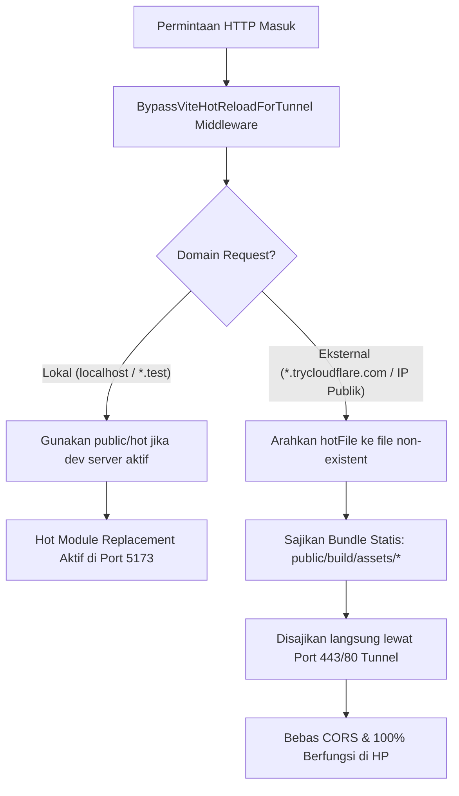

# Panduan Konfigurasi Cloudflare Tunnel & Penanganan Aset Vite
## Sistem Usulan Obat Formularium RS (RS Aisyiyah Siti Fatimah Tulangan)

Dokumen ini menjelaskan mekanisme perutean akses publik melalui **Cloudflare Tunnel**, arsitektur penanganan aset frontend (Vite & Tailwind CSS v4), serta panduan operasional pada lingkungan **Windows (Laravel Herd)** dan **macOS (MacPorts)**.

---

## 1. Latar Belakang & Masalah Teknis

### 1.1 Kebutuhan Operasional
Dalam siklus pengumpulan usulan formularium tahunan, tautan formulir perlu diuji coba secara langsung oleh para Dokter Penanggung Jawab Pelayanan (DPJP) dan Tim Farmasi melalui perangkat *mobile* (smartphone) atau jaringan luar sebelum sistem diterapkan penuh di server produksi.

Cloudflare Tunnel (`cloudflared`) digunakan untuk mengekspos server lokal ke domain publik HTTPS sementara (`https://*.trycloudflare.com`) secara aman tanpa membuka port router (*port forwarding*) atau memerlukan IP publik statis.

### 1.2 Tantangan Pada Laravel Vite
Laravel modern menggunakan Vite untuk memfasilitasi *Hot Module Replacement* (HMR). Saat perintah `npm run dev` aktif:
1. Vite Dev Server berjalan di port lokal `5173`.
2. Laravel mendeteksi file penanda `public/hot` yang berisi alamat dev server lokal (misalnya `https://hospital-formulary-drug-proposal-system.test:5173`).
3. Direktif Blade `@vite(...)` merender skrip yang mengarah langsung ke port `5173`.

#### Kendala yang Terjadi Saat Menggunakan Tunnel:
- **Pelanggaran Kebijakan CORS (*Cross-Origin Resource Sharing*)**:
  Browser membuka halaman dari origin `https://*.trycloudflare.com`, namun mencoba mengunduh skrip dari `https://hospital-formulary-drug-proposal-system.test:5173`. Plugin Vite Laravel secara default membatasi CORS hanya untuk `localhost`, `APP_URL`, dan `*.test`. Akibatnya, browser memblokir aset dengan pesan:
  ```text
  Access to script at 'https://...test:5173/@vite/client' from origin 'https://...trycloudflare.com' 
  has been blocked by CORS policy: No 'Access-Control-Allow-Origin' header is present on the requested resource.
  ```
- **Koneksi Gagal pada Perangkat Eksternal / Mobile**:
  Perangkat smartphone dokter yang membuka link tunnel tidak berada di jaringan lokal dan tidak memiliki catatan DNS untuk domain `.test` atau `localhost`. Akibatnya, JavaScript dan CSS gagal dimuat (*net::ERR_NAME_NOT_RESOLVED* / *ERR_CONNECTION_REFUSED*), membuat antarmuka formulir tidak dapat berfungsi.

---

## 2. Arsitektur Solusi Terintegrasi

Sistem mengadopsi pendekatan **Isolasi Aset Cerdas Berbasis Domain (*Domain-Aware Asset Routing*)** dengan dua lapisan perlindungan:



### 2.1 Lapisan 1: Middleware `BypassViteHotReloadForTunnel`
Middleware `app/Http/Middleware/BypassViteHotReloadForTunnel.php` dieksekusi pada setiap request web:

```php
namespace App\Http\Middleware;

use Closure;
use Illuminate\Http\Request;
use Illuminate\Support\Facades\Vite;
use Symfony\Component\HttpFoundation\Response;

class BypassViteHotReloadForTunnel
{
    public function handle(Request $request, Closure $next): Response
    {
        $host = $request->getHost();

        // Jika request datang dari domain tunnel (*.trycloudflare.com) atau jaringan luar,
        // alihkan hotFile agar Laravel otomatis menyajikan bundle aset produksi di public/build.
        if (! in_array($host, ['localhost', '127.0.0.1', '::1'], true) && ! str_ends_with($host, '.test')) {
            Vite::useHotFile(storage_path('framework/non-existent-hot'));
        }

        return $next($request);
    }
}
```

Middleware ini didaftarkan di `bootstrap/app.php` setelah `$middleware->trustProxies(at: '*')`:
- **Ketika dibuka di laptop lokal (`*.test`)**: Pengembang tetap dapat memanfaatkan live-reload Vite saat ngoding.
- **Ketika dibuka melalui Cloudflare Tunnel atau HP**: Laravel secara transparan mengabaikan dev server port 5173 dan menyajikan file kompilasi statis dari folder `public/build/assets/` melalui jalur tunnel yang sama.

### 2.2 Lapisan 2: Konfigurasi CORS pada Vite (`vite.config.js`)
Pada `vite.config.js`, opsi `server.cors: true` diaktifkan sebagai pertahanan berlapis (*defense-in-depth*):

```javascript
export default defineConfig({
    plugins: [
        laravel({
            input: ['resources/css/app.css', 'resources/js/app.js'],
            refresh: true,
        }),
        tailwindcss(),
    ],
    server: {
        cors: true,
        watch: {
            ignored: ['**/storage/framework/views/**'],
        },
    },
});
```
Ini memastikan bahwa dev server Vite memberikan header `Access-Control-Allow-Origin: *` apabila ada request lintas-origin lokal yang mengakses port dev secara langsung.

---

## 3. Panduan Operasional di Windows (Laravel Herd)

Pada Windows, sistem berjalan di bawah Laravel Herd dengan Virtual Host HTTPS:
`https://hospital-formulary-drug-proposal-system.test`

### 3.1 Skrip `tunnel.bat`
Gunakan file batch yang telah disediakan di root proyek: `tunnel.bat`.

```bat
@echo off
setlocal
echo ========================================================
echo   Tunneling Laravel Herd Virtual Host
echo   Target: https://hospital-formulary-drug-proposal-system.test
echo ========================================================
echo.

:: 1. Hapus file public\hot jika tertinggal dari npm run dev sebelumnya
if exist "public\hot" del /f /q "public\hot"

:: 2. Pastikan aset frontend ter-compile untuk akses publik bebas CORS
echo Menyiapkan aset produksi (npm run build)...
call npm run build
echo.

set CLOUDFLARED_BIN="C:\Program Files (x86)\cloudflared\cloudflared.exe"
if not exist %CLOUDFLARED_BIN% (
    set CLOUDFLARED_BIN=cloudflared
)

echo Menghubungkan Cloudflare Tunnel...
echo Buka URL *.trycloudflare.com yang muncul di bawah ini.
echo Tekan Ctrl+C untuk menghentikan tunnel.
echo.

%CLOUDFLARED_BIN% tunnel --url https://hospital-formulary-drug-proposal-system.test --http-host-header hospital-formulary-drug-proposal-system.test --no-tls-verify

endlocal
```

### 3.2 Cara Menjalankan
Buka PowerShell atau Command Prompt pada root repositori, lalu ketik:
```powershell
.\tunnel.bat
```

> [!NOTE]
> Parameter `--http-host-header hospital-formulary-drug-proposal-system.test` wajib disertakan agar Nginx bawaan Laravel Herd dapat mengenali vhost yang dituju. Parameter `--no-tls-verify` digunakan untuk menerima sertifikat TLS lokal Herd.

---

## 4. Panduan Operasional di macOS (MacPorts)

Pada macOS menggunakan MacPorts, web server (Apache/Nginx) atau `php artisan serve` biasanya telah dikonfigurasi dengan vhost lokal atau port tertentu.

### 4.1 Skrip `tunnel.sh`
Gunakan skrip shell bash yang telah disediakan di root proyek: `tunnel.sh`. File ini sudah memiliki izin eksekusi (`chmod +x`).

```bash
#!/usr/bin/env bash
set -e

# Pindah ke direktori root proyek
cd "$(dirname "${BASH_SOURCE[0]}")"

echo "========================================================"
echo "  Cloudflare Tunnel Helper (macOS / MacPorts)"
echo "========================================================"
echo ""

# 0. Deteksi binary cloudflared
CLOUDFLARED_BIN="$(command -v cloudflared 2>/dev/null || true)"
if [ -z "$CLOUDFLARED_BIN" ]; then
    if [ -x "$HOME/.local/bin/cloudflared" ]; then
        CLOUDFLARED_BIN="$HOME/.local/bin/cloudflared"
    elif [ -x "/opt/local/bin/cloudflared" ]; then
        CLOUDFLARED_BIN="/opt/local/bin/cloudflared"
    else
        echo "Error: Binary 'cloudflared' tidak ditemukan di PATH."
        exit 1
    fi
fi

# 1. Hapus file public/hot jika tersisa dari npm run dev sebelumnya
if [ -f "public/hot" ]; then
    echo "Membersihkan public/hot..."
    rm -f "public/hot"
fi

# 2. Build aset produksi bebas CORS
echo "Menyiapkan aset produksi (npm run build)..."
npm run build
echo ""

# 3. Jalankan cloudflared tunnel
DEFAULT_URL="${TUNNEL_URL:-http://localhost:8000}"

echo "Menjalankan Cloudflare Tunnel..."
if [ $# -eq 0 ]; then
    echo "Target: $DEFAULT_URL"
    echo "Buka URL *.trycloudflare.com yang muncul di bawah ini."
    echo "Tekan Ctrl+C untuk menghentikan tunnel."
    echo ""
    "$CLOUDFLARED_BIN" tunnel --url "$DEFAULT_URL"
else
    echo "Parameter kustom: $@"
    echo "Tekan Ctrl+C untuk menghentikan tunnel."
    echo ""
    "$CLOUDFLARED_BIN" tunnel "$@"
fi
```

### 4.2 Cara Menjalankan
1. **Mode Default (Quick Tunnel ke `http://localhost:8000`)**:
   Secara default, skrip otomatis mengarahkan tunnel ke `http://localhost:8000` (port standar `php artisan serve` / `composer dev`) atau nilai variabel `TUNNEL_URL`:
   ```bash
   ./tunnel.sh
   ```
2. **Mode Parameter Kustom (URL Spesifik / Named Tunnel)**:
   Jika Anda ingin mengarahkan tunnel ke URL/port tertentu atau menjalankan sub-perintah cloudflared lainnya:
   ```bash
   ./tunnel.sh --url http://127.0.0.1:8080
   ```

---

## 5. Ringkasan Perilaku Sistem

| Skenario Akses | URL yang Dibuka | Sumber Aset Frontend | Status CORS | Fungsi di HP |
| :--- | :--- | :--- | :--- | :--- |
| **Pengembangan Lokal** (`npm run dev` aktif) | `https://hospital-formulary-drug-proposal-system.test` | Vite Dev Server (`:5173`) | Diizinkan (`*.test` & `cors: true`) | Khusus PC Lokal |
| **Akses Publik / Demo** | `https://*.trycloudflare.com` | Bundle Statis (`public/build/*`) | **Bebas CORS (100% Aman)** | **Berfungsi Sempurna** |
| **Akses Lokal Tanpa Dev Server** | `https://hospital-formulary-drug-proposal-system.test` | Bundle Statis (`public/build/*`) | Bebas CORS | Khusus PC Lokal |

---

## 6. Verifikasi & Pengujian Otomatis

Untuk memastikan mekanisme isolasi tunnel ini tidak mengalami regresi di kemudian hari, telah disediakan unit test di `tests/Feature/TunnelViteAssetResolutionTest.php`.

Jalankan pengujian kapan saja menggunakan Pest PHP:
```bash
# Uji khusus resolusi aset tunnel
./vendor/bin/pest tests/Feature/TunnelViteAssetResolutionTest.php

# Uji seluruh suite aplikasi
./vendor/bin/pest
```
Test ini memvalidasi bahwa ketika file `public/hot` ada di disk, permintaan dari domain `trycloudflare.com` tetap memuat aset produksi `/build/assets/` dan tidak pernah membocorkan URL dev server `:5173`.
