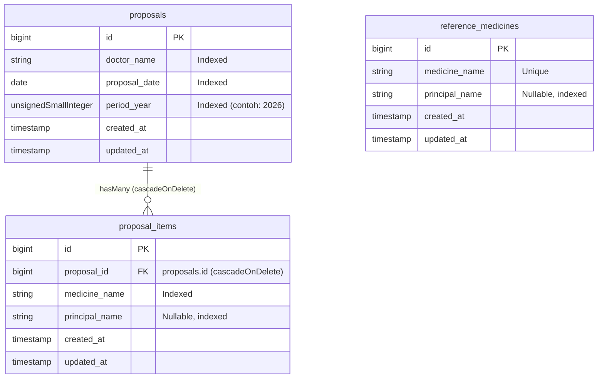

# Dokumen Spesifikasi Teknis (Spec): Sistem Usulan Obat Formularium RS

- **Nama Proyek:** Sistem Usulan Obat Formularium RS (RS Aisyiyah Siti Fatimah Tulangan)
- **Direktori Target:** `/Users/adijaya/MyFiles/Projects/RSAisyiahSitiFatimahTulangan/FormulariumRS`
- **Tanggal Spesifikasi:** 3 November 2026
- **Status:** Draft Menunggu Persetujuan Akhir (`SPECIFY` Phase)
- **Zona Waktu Aplikasi:** `Asia/Jakarta` (`WIB`) / Locale UI `id`

---

## 1. Objective (Tujuan, Konteks & Kriteria Keberhasilan)

### 1.1 Latar Belakang & Masalah
Setiap tahun pada bulan November, RS Aisyiyah Siti Fatimah Tulangan mengumpulkan usulan obat baru dari para Dokter Penanggung Jawab Pelayanan (DPJP) untuk evaluasi Farmasi ke dalam Formularium RS. Penggunaan Google Form terkendala karena:
1. Tidak mendukung input baris berulang (*dynamic form repeater*) untuk banyak obat dalam satu pengajuan.
2. Tidak terhubung dengan daftar dokter dari REST API internal RS (`portalsifast`) maupun fitur *autocomplete* nama obat & principle yang fleksibel namun terarah.

### 1.2 Pengguna Utama
1. **Dokter / DPJP RS (Pengusul):** Mengakses form melalui tautan WhatsApp dari smartphone saat visite maupun PC poliklinik tanpa hambatan login.
2. **Farmasi (Pemantau & Pengolah Data):** Memantau rekapitulasi secara langsung, menghubungkan data ke Google Sheets / Microsoft Excel secara *live*, dan mengunduh laporan statis `.xlsx`.

### 1.3 Goals, Non-Goals, & Anti-Goals
- **Goals (Sasaran Utama):**
  - Pengalaman pengisian *zero-friction* (< 1 menit untuk mengajukan beberapa obat dari layar HP).
  - *Searchable Combobox* Nama Dokter dari API `portalsifast` dengan dukungan *fallback* input manual (untuk dokter non-poli seperti Sp.An/IGD) dan ketahanan terhadap gangguan jaringan API eksternal.
  - *Self-learning Autocomplete* untuk `Nama Obat` dan `Nama Principle` yang diperkaya data awal 206 obat & principle dari CSV Formularium RS, lengkap dengan *auto-fill* Principle saat obat dipilih.
  - Sinkronisasi ke Google Sheets (`=IMPORTDATA`) / Excel Power Query melalui endpoint Live CSV ber-token serta fitur unduh `.xlsx` rapi.
- **Non-Goals (Di Luar Cakupan / Out of Scope):**
  - Tidak ada sistem autentikasi login, manajemen user, maupun kode PIN pada Halaman Form maupun Halaman Rekapitulasi.
  - Tidak ada kolom input `Bahan Aktif`, harga obat, alasan klinis panjang, atau status persetujuan Farmasi di dalam aplikasi.
  - Tidak ada fitur edit atau hapus baris usulan dari antarmuka web publik (demi keamanan data karena halaman terbuka tanpa login).
  - Tidak melakukan perubahan kode apa pun pada repositori `PortalSifast`.
- **Anti-Goals (Hal yang Harus Dihindari):**
  - Jangan memanggil API `portalsifast` langsung dari browser (risiko blokir CORS & lambat).
  - Jangan menjadikan Google Sheets sebagai penyimpanan utama pada jalur request submit dokter.
  - Jangan menggunakan `firstOrCreate()` pada tabel master saat submit form yang dapat memicu *Unique Constraint Race Condition*.
  - Jangan menampilkan badge/status `"Sudah Masuk"` pada saran Autocomplete obat.

---

## 2. Keputusan Arsitektur & Pendekatan (Approaches)

Berikut ringkasan alternatif arsitektur yang telah dievaluasi dan keputusan yang dipilih:

| Area Keputusan | Opsi yang Dipertimbangkan | Keputusan Terpilih & Alasan |
| :--- | :--- | :--- |
| **Batas Proyek** | A. Standalone Laravel 12 App (`FormulariumRS`)<br>B. Modul publik di dalam `PortalSifast` | **Opsi A (Standalone App):** Isolasi penuh untuk aplikasi siklus tahunan (aktif tiap November), mudah di-backup per file, dan nol risiko regresi ke operasional harian SIMRS/PortalSifast. |
| **Frontend Stack** | A. Laravel Blade + Alpine.js + Tailwind CSS v4<br>B. React 19 + Inertia.js v2 + TypeScript | **Opsi A (Blade + Alpine.js + Tailwind v4):** Beban JS sangat kecil (~15 KB gzipped) untuk koneksi seluler di bangsal RS, cukup kaya untuk *dynamic repeater* & *combobox*, serta minim *dependency churn* saat aplikasi tidur 11 bulan. |
| **Database Utama** | A. SQLite (`WAL` mode + `busy_timeout=5000`)<br>B. MariaDB / MySQL | **Opsi A (SQLite WAL):** Bebas perawatan server DB, backup tahunan cukup menyalin 1 file `database.sqlite`, aman terhadap *concurrent read/write*, dan ditulis 100% dengan Laravel Migration & Eloquent standar agar siap pindah ke MariaDB kapan saja lewat `.env`. |
| **Sumber Data Dokter** | A. `/api/dokter` + *Combobox* fleksibel (bisa ketik manual)<br>B. Ubah API `PortalSifast` tanpa join jadwal<br>C. Kunci ketat 24 dokter `/api/dokter` | **Opsi A:** Endpoint `/api/dokter` hanya mengembalikan 24 dokter berjadwal poliklinik. *Combobox* fleksibel memastikan DPJP non-poliklinik (misal Sp.An, Sp.Rad, Sp.PK, Dokter IGD) tetap bisa mengisi form tanpa mengubah `PortalSifast`. |
| **Autocomplete Obat & Principle** | A. Seed CSV ke tabel referensi read-only + union `proposal_items` + *Auto-fill* Principle (tanpa badge)<br>B. Murni `SELECT DISTINCT proposal_items` dari nol | **Opsi A:** Menghilangkan masalah *cold-start* di hari pertama menggunakan 206 obat & ~27 principle dari CSV RS, mempercepat input dokter lewat *auto-fill* Principle, dan tetap 0% risiko *race condition* karena tabel referensi tidak ditulis saat submit. |
| **Live Sync Spreadsheet** | A. Endpoint Live CSV ber-token (`=IMPORTDATA` / Power Query) + Export `.xlsx`<br>B. Google Apps Script Webhook<br>C. Google Sheets REST API (Service Account) | **Opsi A:** Paling praktis tanpa pemeliharaan kredensial Google Cloud atau script eksternal, kompatibel dengan Google Sheets maupun Microsoft Excel, dan selalu mencerminkan *Single Source of Truth* SQLite. |

---

## 3. Tech Stack & Konfigurasi Inti

- **Runtime & Framework:** PHP `^8.3`, Laravel `^12.0`
- **Database:** SQLite 3 (`database/database.sqlite`) dengan konfigurasi PRAGMA wajib pada `config/database.php`:
  - `journal_mode = WAL`
  - `busy_timeout = 5000`
  - `synchronous = NORMAL`
  - `foreign_key_constraints = true`
- **Frontend:**
  - Laravel Blade Components
  - **Alpine.js `^3.14`** (di-bundle lokal melalui NPM/Vite di `resources/js/app.js`, **bukan** dari CDN eksternal agar aplikasi tetap berjalan cepat meskipun internet luar RS sedang lambat)
  - **Tailwind CSS `^4.0`** (`@tailwindcss/vite`, konfigurasi `@theme` langsung di `resources/css/app.css` tanpa `tailwind.config.js`)
- **Excel (.xlsx) Writer:** `openspout/openspout` (`^4.28`) — ringan, cepat, mendukung styling header tebal/warna, border sel, dan lebar kolom tanpa konsumsi memori besar.
- **Testing & Code Quality:** `pestphp/pest` (`^3.0` / `^4.0`), `laravel/pint`.

### Variabel `.env` Khusus Aplikasi (`config/formulary.php`)
```dotenv
APP_TIMEZONE=Asia/Jakarta
APP_LOCALE=id

DB_CONNECTION=sqlite
DB_FOREIGN_KEYS=true

DOCTOR_API_URL="https://portalsifast.rsaisyiyahsitifatimah.com/api/dokter"
DOCTOR_API_TIMEOUT=10
DOCTOR_CACHE_TTL_HOURS=12

# Token statis untuk mengamankan URL Live CSV Feed Spreadsheet
# Wajib di-generate acak minimal 32 karakter saat setup (.env)
FORMULARY_FEED_TOKEN=""
```

---

## 4. Rancangan Skema Database & Model Eloquent

Seluruh nama tabel, kolom, model, controller, dan rute wajib mengikuti **Strict English Laravel Convention**.

### 4.1 Diagram Relasi Entitas


### 4.2 Detail Tabel & Indeks
1. **Tabel `proposals` (Model: `App\Models\Proposal`)**
   - `id`: `$table->id()`
   - `doctor_name`: `$table->string('doctor_name')->index()` — menyimpan nama lengkap dokter dalam bentuk string utuh (contoh: `"dr. Ahmad Nadhir Sp. U. M. Ked. Klin"`).
   - `proposal_date`: `$table->date('proposal_date')->index()`
   - `period_year`: `$table->unsignedSmallInteger('period_year')->index()` — dihitung otomatis di backend dari `(int) Carbon::parse($proposalDate)->year`.
   - `timestamps()`
   - Relasi: `public function items(): HasMany` → `ProposalItem::class`

2. **Tabel `proposal_items` (Model: `App\Models\ProposalItem`)**
   - `id`: `$table->id()`
   - `proposal_id`: `$table->foreignId('proposal_id')->constrained('proposals')->cascadeOnDelete()`
   - `medicine_name`: `$table->string('medicine_name')->index()`
   - `principal_name`: `$table->string('principal_name')->nullable()->index()`
   - `timestamps()`
   - Relasi: `public function proposal(): BelongsTo` → `Proposal::class`

3. **Tabel `reference_medicines` (Model: `App\Models\ReferenceMedicine`)**
   - `id`: `$table->id()`
   - `medicine_name`: `$table->string('medicine_name')->unique()`
   - `principal_name`: `$table->string('principal_name')->nullable()->index()`
   - `timestamps()`
   - *Catatan:* Tabel ini hanya diisi oleh Seeder / Artisan Command (`php artisan formulary:import-csv`), dan **bersifat read-only** pada saat transaksi pengajuan dokter berlangsung.

### 4.3 Normalisasi Input & Seeder CSV Awal
- **Sumber Seeder Awal:** Berkas CSV dari `/Users/adijaya/Downloads/REKAP FORMULARIUM RS - daftar obat.csv` disalin ke `database/seeders/data/formulary_medicines.csv`.
- **Aturan Parsing CSV (`formulary:import-csv` & `ReferenceMedicineSeeder`):**
  - Abaikan baris judul/header dan baris yang kolom `NAMA OBAT` (indeks `1`) kosong.
  - Bersihkan spasi berlebih (`trim` dan kompresi spasi beruntun menjadi satu spasi).
  - Pada kolom `PRINCIPLE` (indeks `3`), ubah nilai kosong atau `"-"` menjadi `null`, serta normalisasi typo ejaan identik yang ditemukan pada CSV (`"Novel"` → `"Novell"`, `"generik novell"` → `"Novell Generik"`, `"Fahrenheit Generik"` & `"Yarindo Generik"` dirapikan kapitalisasinya).
  - Gunakan `upsert` berdasarkan *case-insensitive* `medicine_name` saat seeding agar idempoten jika dijalankan berulang kali.
- **Aturan Normalisasi Saat Dokter Submit Form:**
  - `doctor_name` dan `medicine_name`: `trim` + kompresi spasi ganda (`preg_replace('/\s+/u', ' ', trim($val))`).
  - `principal_name`: setelah `trim`, jika string kosong `""` atau hanya karakter strip `"-"`, simpan sebagai `null` agar tidak mengotori daftar saran Autocomplete Principle dan filter Rekapitulasi.

---

## 5. Spesifikasi Fitur, Rute & Alur Teknis

### 5.1 Daftar Rute (Routes)
| Method & URI | Route Name | Controller / Action | Deskripsi |
| :--- | :--- | :--- | :--- |
| `GET /` | `proposals.create` | `ProposalController@create` | Halaman Formulir Usulan Obat (halaman utama untuk dokter) |
| `POST /proposals` | `proposals.store` | `ProposalController@store` | Menyimpan pengajuan baru (dilindungi `throttle:30,1` & idempotency lock) |
| `GET /recap` | `proposals.index` | `ProposalRecapController@index` | Halaman Rekapitulasi Usulan & panel koneksi Live Spreadsheet |
| `GET /api/suggestions/medicines` | `suggestions.medicines` | `SuggestionController@medicines` | JSON saran `Nama Obat` beserta pasangan `principal_name` untuk *auto-fill* |
| `GET /api/suggestions/principals` | `suggestions.principals` | `SuggestionController@principals` | JSON saran `Nama Principle` unik |
| `GET /exports/proposals.csv` | `exports.proposals.csv` | `ProposalExportController@csv` | Endpoint Live CSV Feed untuk `=IMPORTDATA` / Excel Power Query (`?token=...`) |
| `GET /exports/proposals.xlsx` | `exports.proposals.xlsx` | `ProposalExportController@xlsx` | Unduh file Excel `.xlsx` terformat rapi sesuai filter aktif |

### 5.2 Integrasi Tangguh Daftar Dokter (`DoctorDirectoryService`)
1. Mengambil data dari `config('formulary.doctor_api_url')` menggunakan `Http::timeout(10)->retry(2, 200)->acceptJson()->get(...)`.
2. Memetakan `data[]` yang `isAktif === true` menjadi array daftar dokter (`namaDokter` dan label poli opsional `poli[0].namaPoli` sebagai sub-teks bantu saat mencari, namun nilai yang masuk ke input form adalah string bersih `namaDokter`).
3. Menyimpan hasil sukses ke:
   - **Laravel Cache** selama 12 jam (`formulary.doctors.api_list`), **DAN**
   - **Snapshot File Lokal** di `storage/app/doctors_snapshot.json`.
4. **Urutan Fallback saat Cache Kedaluwarsa & API Gangguan:**
   - Jika request HTTP ke `portalsifast` timeout/error 5xx, baca dari `storage/app/doctors_snapshot.json` dan simpan sementara ke cache selama 15 menit agar request berikutnya tidak ikut menggantung 10 detik!
5. **Penggabungan Dokter Manual (Self-Learning Dokter Non-Poli):**
   - Gabungkan daftar dari API/snapshot dengan `Proposal::query()->select('doctor_name')->distinct()->pluck('doctor_name')` (deduplikasi *case-insensitive*) sehingga dokter non-poli (seperti Sp.An) yang pernah diketik manual otomatis tersedia di combobox pada pengajuan berikutnya.
6. Karena jumlah dokter hanya puluhan (~24–60 nama), daftar ini di-inject langsung ke Blade saat `GET /` dirender agar pencarian *combobox* bekerja **instan (0ms network delay)** di HP dokter.

### 5.3 Halaman A: Formulir Usulan Obat (`GET /` & `POST /proposals`)
- **Bagian Header:**
  - `Nama Dokter` (`doctor_name`, wajib, maks 255 karakter): Komponen Alpine *Searchable Combobox*. Mendukung pencarian *substring* tidak peka huruf besar/kecil (baik berdasarkan nama dokter maupun nama polikliniknya). Jika ketikan pengguna belum cocok persis dengan opsi yang tersedia, tampilkan opsi aksi jelas di bawah dropdown: `+ Gunakan nama dokter: "{ketikan}"`.
  - `Tanggal Pengajuan` (`proposal_date`, wajib, format `YYYY-MM-DD`): Default otomatis tanggal hari ini (`now()->toDateString()`).
- **Bagian Detail / Dynamic Repeater (`items[]`):**
  - Default terbuka dengan **1 baris kosong**.
  - Validasi `items`: `required|array|min:1|max:50`.
  - Setiap baris memiliki:
    - `items.*.medicine_name`: `required|string|max:255` — *Autocomplete Input* fleksibel.
    - `items.*.principal_name`: `nullable|string|max:255` — *Autocomplete Input* fleksibel (opsional).
  - **Perilaku Auto-Fill Principle:**
    - Endpoint `/api/suggestions/medicines?q=...` mengembalikan maksimal 15 saran teratas berformat `[{ "medicine_name": "Diarvit 100 Mg Tab", "principal_name": "Novell" }, ...]`, hasil gabungan (*case-insensitive union*, memprioritaskan kecocokan awalan lalu *substring*) antara `proposal_items` terbaru dan `reference_medicines`.
    - Ketika pengguna mengklik/memilih salah satu saran obat yang memiliki `principal_name` tidak kosong, maka kolom `principal_name` pada baris tersebut otomatis terisi apabila kolom `principal_name` masih kosong atau sebelumnya diisi secara *auto-fill*. Pengguna tetap bebas mengubah atau menghapus isi `principal_name`.
    - Tidak menampilkan badge status `"Sudah Masuk"`.
  - **Kontrol Baris:**
    - Tombol `+ Tambah Baris Obat` di bawah daftar item (otomatis mengarahkan fokus kursor ke input `Nama Obat` baris baru).
    - Tombol `Hapus Baris` di setiap item (dinonaktifkan jika hanya tinggal 1 baris).
  - **Pemulihan Error Validasi:** Jika validasi gagal, `old('items')` dirender kembali ke state awal Alpine sehingga tidak ada baris ketikan dokter yang hilang.
- **Transaksi & Pencegahan Double-Submit:**
  - Client-side: Saat form disubmit, kunci tombol submit (`disabled`) dan ubah teks tombol menjadi indikator proses `"Menyimpan Usulan..."`.
  - Server-side Idempotency: Hitung hash SHA-256 dari payload ternormalisasi (`mb_strtolower($doctorName) . '|' . $proposalDate . '|' . json_encode($normalizedItems)`). Gunakan `Cache::add("formulary:idempotency:{$hash}", true, now()->addSeconds(15))`. Jika kunci tersebut sudah ada (klik ganda / retry jaringan dalam 15 detik), lewati proses insert dan kembalikan redirect sukses yang identik.
  - Simpan `Proposal` beserta seluruh `ProposalItem` di dalam satu blok `DB::transaction()`.
- **UX Pasca-Submit:** Redirect `303/302` ke `GET /` dengan flash notifikasi sukses yang merangkum nama dokter, tanggal, dan jumlah obat yang berhasil disimpan, sehingga reload halaman (`F5` / tarik layar di HP) tidak memicu *resubmit POST*.

### 5.4 Halaman B: Rekapitulasi Usulan & Live Spreadsheet (`GET /recap`)
- **Navigasi:** Header aplikasi memiliki tab berpindah cepat antara **Formulir Usulan** (`/`) dan **Rekapitulasi Usulan** (`/recap`).
- **Ringkasan Statistik Cepat (ikut berubah sesuai Tahun Periode / Filter):**
  - Total Baris Obat Diusulkan
  - Total Dokter Pengusul Unik
  - Total Pengajuan (Form Submit)
- **Filter & Pencarian (`GET` query params):**
  - `period_year`: Dropdown tahun periode (dinamis dari `SELECT DISTINCT period_year` + tahun berjalan, default menampilkan tahun berjalan atau opsi `Semua Tahun` — **Keputusan Builder: default `Semua Tahun` atau tahun berjalan? Default ke tahun berjalan `now()->year` hanya jika ada opsi `Semua Tahun` yang jelas; lebih aman default ke `Semua Tahun` pada tampilan awal agar data lintas akhir tahun tidak "terlihat kosong", dengan chip cepat pilih tahun misal `2026`**).
  - `doctor`: Filter dropdown berdasarkan `doctor_name` unik di `proposals`.
  - `principal`: Filter dropdown berdasarkan `principal_name` unik di `proposal_items`.
  - `date_from` & `date_to`: Rentang `proposal_date`.
  - `search`: Pencarian teks bebas pada `medicine_name`, `principal_name`, atau `doctor_name`.
- **Tabel Gabungan (Flattened Join `proposal_items` + `proposals`):**
  - Urutan default: `proposals.proposal_date DESC, proposals.id DESC, proposal_items.id ASC`.
  - Kolom UI: `No`, `Tanggal`, `Nama Dokter`, `Nama Obat`, `Nama Principle` (tampilkan `-` jika `null`).
  - Pagination: 25 baris per halaman dengan `withQueryString()`.
- **Panel / Modal "Koneksi Live Spreadsheet":**
  - Menampilkan URL Live CSV Feed lengkap dengan token aktif (jika `FORMULARY_FEED_TOKEN` telah dikonfigurasi).
  - Menyediakan kotak rumus siap salin (1-klik tombol *Salin Rumus*) untuk Google Sheets:
    `=IMPORTDATA("https://domain-rs/exports/proposals.csv?token=...")` (serta variasi dengan `&period_year=2026`).
  - Menyediakan panduan ringkas 3 langkah untuk Microsoft Excel (*Tab Data → From Web → Paste URL CSV → Load*).
- **Spesifikasi Endpoint Live CSV (`GET /exports/proposals.csv`):**
  - Validasi query `token`: wajib cocok menggunakan `hash_equals()` terhadap `config('formulary.feed_token')`. Jika `feed_token` di server kosong atau tidak cocok, kembalikan HTTP `403 Forbidden`.
  - Mendukung filter opsional `?period_year=2026`.
  - Streaming response (`response()->stream(...)`) dengan header `Content-Type: text/csv; charset=UTF-8`, `Cache-Control: no-store, no-cache, must-revalidate`.
  - Kolom CSV: `No,Tanggal,Tahun Periode,Nama Dokter,Nama Obat,Nama Principle,Waktu Input`.
  - **Keamanan CSV Formula Injection:** Setiap nilai teks yang diawali karakter `=`, `+`, `-`, `@`, `\t`, atau `\r` wajib diprefiks dengan tanda kutip tunggal `'` saat serialisasi CSV/Excel agar aman dibuka di Google Sheets maupun Excel.
- **Spesifikasi Export Excel (`GET /exports/proposals.xlsx`):**
  - Menerapkan seluruh parameter filter yang sedang aktif di Halaman Rekapitulasi (`period_year`, `doctor`, `principal`, `date_from`, `date_to`, `search`).
  - Nama berkas: `Rekap_Usulan_Obat_Formularium_RS_{YYYY-MM-DD_HHmm}.xlsx`.
  - Format visual menggunakan `openspout`:
    - Baris judul laporan & tanggal cetak di bagian atas.
    - Baris header tabel tebal (*bold*), latar hijau tua (`#065F46`), teks putih (`#FFFFFF`), rata tengah/kiri proporsional.
    - Lebar kolom terukur rapi (*explicit column widths* yang dihitung dinamis dari panjang konten, dibatasi min–max wajar) serta border tipis di seluruh sel data.

---

## 6. Commands (Perintah Eksekusi Proyek)

Seluruh perintah berikut dijalankan dari direktori `/Users/adijaya/MyFiles/Projects/RSAisyiahSitiFatimahTulangan/FormulariumRS`:

```bash
# Setup awal & migrasi + seed 206 obat CSV
composer install
cp .env.example .env
php artisan key:generate
touch database/database.sqlite
php artisan migrate --seed
npm install
npm run build

# Menjalankan server pengembangan lokal (Laravel + Vite)
composer run dev

# Import ulang / update kamus CSV obat & principle kapan saja
php artisan formulary:import-csv database/seeders/data/formulary_medicines.csv

# Menjalankan seluruh pengujian otomatis (Pest)
./vendor/bin/pest

# Pemeriksaan gaya kode PHP (Laravel Pint) & build aset produksi
./vendor/bin/pint --test
npm run build
```

---

## 7. Project Structure (Struktur Direktori)

```text
FormulariumRS/
├── app/
│   ├── Console/Commands/
│   │   └── ImportFormularyCsvCommand.php   # Command import CSV kamus obat/principle
│   ├── Http/
│   │   ├── Controllers/
│   │   │   ├── ProposalController.php      # GET / (form) & POST /proposals (simpan)
│   │   │   ├── ProposalRecapController.php # GET /recap (tabel rekapitulasi & filter)
│   │   │   ├── ProposalExportController.php# GET /exports/proposals.csv & .xlsx
│   │   │   └── SuggestionController.php    # GET /api/suggestions/medicines & principals
│   │   └── Requests/
│   │       └── StoreProposalRequest.php    # Validasi & normalisasi spasi header + repeater
│   ├── Models/
│   │   ├── Proposal.php                    # Header pengajuan (proposals)
│   │   ├── ProposalItem.php                # Detail baris obat (proposal_items)
│   │   └── ReferenceMedicine.php           # Kamus referensi CSV (reference_medicines)
│   ├── Services/
│   │   ├── DoctorDirectoryService.php      # Fetch API portalsifast + Cache + JSON Snapshot + Union DB
│   │   ├── AutocompleteService.php         # Union case-insensitive ReferenceMedicine + ProposalItem
│   │   └── ProposalExportService.php       # Generator stream CSV aman & XLSX berformat (OpenSpout)
│   └── Support/
│       └── SpreadsheetSanitizer.php        # Sanitasi anti CSV/Excel Formula Injection & normalisasi teks
├── config/
│   └── formulary.php                       # Konfigurasi URL API dokter, TTL cache, & feed token
├── database/
│   ├── factories/                          # Factory Proposal, ProposalItem, ReferenceMedicine
│   ├── migrations/                         # Migrasi proposals, proposal_items, reference_medicines
│   └── seeders/
│       ├── DatabaseSeeder.php
│       ├── ReferenceMedicineSeeder.php
│       └── data/
│           └── formulary_medicines.csv     # Salinan CSV 206 obat & principle RS
├── resources/
│   ├── css/app.css                         # Tailwind CSS v4 @theme (palet hijau zamrud RS)
│   ├── js/app.js                           # Inisialisasi Alpine.js & komponen form/combobox/repeater
│   └── views/
│       ├── components/layout.blade.php     # Shell utama responsif mobile & desktop
│       └── proposals/
│           ├── create.blade.php            # Halaman Formulir Usulan Obat
│           └── index.blade.php             # Halaman Rekapitulasi & Modal Live Spreadsheet
├── routes/
│   └── web.php                             # Definisi seluruh rute aplikasi
└── tests/
    ├── Feature/
    │   ├── ProposalSubmissionTest.php      # Uji simpan atomik, validasi, idempotency double-submit
    │   ├── DoctorDirectoryServiceTest.php  # Uji HTTP fake, cache, fallback snapshot saat API down
    │   ├── AutocompleteSuggestionTest.php  # Uji union CSV + self-learning, deduplikasi, auto-fill
    │   ├── ProposalRecapFilterTest.php     # Uji halaman rekap & kombinasi semua filter
    │   └── ProposalExportTest.php          # Uji token CSV 403/200, formula injection, & unduh XLSX
    └── Unit/
        └── CsvImportNormalizationTest.php  # Uji pembersihan CSV RS & normalisasi nama principle
```

---

## 8. Code Style & Konvensi

- **Bahasa Kode vs Bahasa UI:** 100% Bahasa Inggris untuk tabel, kolom, class, method, variabel, dan route; 100% Bahasa Indonesia yang jelas dan sopan untuk seluruh label UI, placeholder, dan pesan validasi (`StoreProposalRequest::messages()`).
- **Strict Types & Typed Properties:** Gunakan `declare(strict_types=1);` atau return type eksplisit pada seluruh class PHP baru sesuai standar Laravel 12 & Laravel Pint.
- **Contoh Gaya Kode (Model & Transaksi):**

```php
<?php

declare(strict_types=1);

namespace App\Models;

use Illuminate\Database\Eloquent\Model;
use Illuminate\Database\Eloquent\Relations\HasMany;

class Proposal extends Model
{
    protected $fillable = [
        'doctor_name',
        'proposal_date',
        'period_year',
    ];

    protected function casts(): array
    {
        return [
            'proposal_date' => 'date',
            'period_year' => 'integer',
        ];
    }

    public function items(): HasMany
    {
        return $this->hasMany(ProposalItem::class);
    }
}
```

---

## 9. Testing Strategy (Strategi Pengujian)

- **Framework:** Pest PHP menggunakan database in-memory/file SQLite terisolasi (`RefreshDatabase`) dan `Http::fake()` (tidak pernah memanggil API produksi `portalsifast` saat test otomatis).
- **Cakupan Wajib (Feature & Unit Tests):**
  1. **Submission & Master-Detail:** Submit 1 dokter dengan 3 baris obat menyimpan 1 `Proposal` (`period_year` otomatis sesuai tahun `proposal_date`) dan 3 `ProposalItem` (dengan `principal_name` terisi maupun `null`), serta menormalisasi spasi berlebih.
  2. **Idempotency Double-Submit:** Dua POST identik beruntun dalam jeda < 15 detik hanya menghasilkan 1 `Proposal` di database tanpa error bagi pengguna.
  3. **Ketahanan API Dokter:** Saat `Http::fake()` mengembalikan data valid → tersimpan di cache & file snapshot; saat `Http::fake()` mengembalikan HTTP 500 / ConnectionException → otomatis jatuh ke file snapshot lokal tanpa membuat halaman `GET /` crash.
  4. **Autocomplete & CSV Seed:** `ReferenceMedicineSeeder` berhasil memuat seluruh obat unik dari `formulary_medicines.csv`, menormalisasi `"Novel"` → `"Novell"`, mengembalikan pasangan `principal_name` untuk *auto-fill*, serta langsung menyertakan obat/principle baru yang disubmit ke `proposal_items` tanpa duplikat *case-insensitive*.
  5. **Keamanan & Akurasi Export:** `GET /exports/proposals.csv` menolak request tanpa token / salah token (`403`), mengembalikan CSV valid dengan sanitasi formula injection (`=CMD()` → `'=CMD()`) saat token benar, dan `GET /exports/proposals.xlsx` mengembalikan file `.xlsx` valid (`200`, header MIME SpreadsheetML, ukuran > 0 byte) sesuai filter.

---

## 10. Boundaries (Batasan Kerja Agen & Pengembang)

- **Always Do (Wajib Dilakukan):**
  - Jalankan `./vendor/bin/pest`, `./vendor/bin/pint --test`, dan `npm run build` hingga lulus 100% sebelum menyatakan suatu tahap selesai.
  - Gunakan Eloquent ORM / Query Builder standar yang kompatibel di SQLite **maupun** MariaDB (hindari fungsi SQL khusus SQLite yang tidak jalan di MariaDB).
  - Bungkus penulisan multi-tabel dalam `DB::transaction()`.
  - Sanitasi output CSV/Excel terhadap *Formula Injection*.
- **Ask First (Tanyakan Terlebih Dahulu):**
  - Mengubah struktur kolom `proposals` atau `proposal_items`.
  - Menambahkan autentikasi/PIN atau fitur hapus/edit data pada antarmuka publik.
  - Menambahkan dependency Composer/NPM berat di luar daftar spesifikasi ini.
- **Never Do (Dilarang Keras):**
  - Menyentuh, mengubah, atau memodifikasi file apa pun di dalam folder `PortalSifast` atau `Official-Website-RSUASF`.
  - Meng-commit kredensial rahasia atau file `.env` produksi ke Git.
  - Menggunakan `firstOrCreate()` ke tabel referensi saat proses submit dokter.

---

## 11. Testable Success Criteria (Daftar Periksa Selesai)

1. [ ] Project Laravel 12 berdiri mandiri di `/Users/adijaya/MyFiles/Projects/RSAisyiahSitiFatimahTulangan/FormulariumRS` dengan SQLite `WAL` mode dan `busy_timeout=5000` terverifikasi aktif (`PRAGMA journal_mode` mengembalikan `wal`).
2. [ ] `php artisan migrate --seed` berhasil mengimpor seluruh daftar obat unik (~206 obat) dan principle bersih dari CSV RS ke `reference_medicines`.
3. [ ] Halaman Formulir (`/`) nyaman di layar mobile (375px) & desktop, *Searchable Combobox* menampilkan 24 dokter `portalsifast` + mengizinkan input dokter manual (misal Sp.An), serta mendukung tambah/hapus banyak baris obat.
4. [ ] Memilih saran obat di Autocomplete otomatis mengisi `Nama Principle` pasangannya (*auto-fill*) tanpa menampilkan badge status `"Sudah Masuk"`, dan form tetap bisa disubmit meskipun `Nama Principle` dikosongkan.
5. [ ] Halaman Rekapitulasi (`/recap`) menampilkan tabel gabungan real-time dengan filter tahun periode, dokter, principle, tanggal, dan pencarian kata kunci.
6. [ ] Endpoint Live CSV (`/exports/proposals.csv?token=...`) siap ditarik `=IMPORTDATA()` / Power Query Excel, dan tombol **Export ke Excel (.xlsx)** mengunduh file `.xlsx` rapi berformat header tebal berwarna & border.
7. [ ] Seluruh pengujian otomatis Pest (`./vendor/bin/pest`), pemeriksaan Pint, dan `npm run build` lulus tanpa error.
